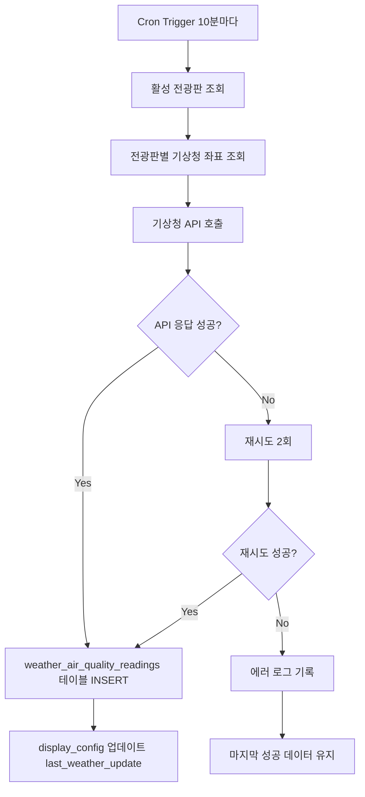
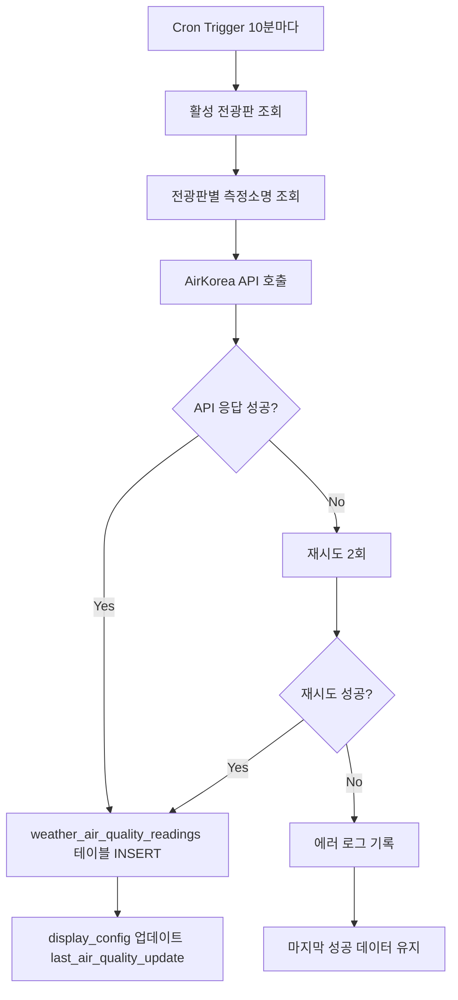

# 01_planning / 03_api_integration.md

# 공공데이터 API 연동 계획

## 1. 연동 API 개요

### 1.1 기상청 단기예보 API

**API 제공기관**: 기상청 (공공데이터포털)  
**용도**: 실시간 기상 정보 수집  
**인증 방식**: API KEY (Encoding/Decoding 키 제공)  
**요금**: 무료  
**일일 호출 제한**: 10,000건

#### 제공 데이터
- 기온 (T1H)
- 강수확률 (POP)
- 하늘상태 (SKY): 맑음(1), 구름많음(3), 흐림(4)
- 강수형태 (PTY): 없음(0), 비(1), 비/눈(2), 눈(3)
- 습도 (REH)
- 풍향 (VEC)
- 풍속 (WSD)

#### API 엔드포인트
```
GET http://apis.data.go.kr/1360000/VilageFcstInfoService_2.0/getUltraSrtFcst
```

#### 요청 파라미터
| 파라미터 | 필수 | 설명 | 예시 |
|----------|------|------|------|
| serviceKey | Y | 인증키 (Decoding) | (발급받은 키) |
| numOfRows | N | 한 페이지 결과 수 | 60 |
| pageNo | N | 페이지 번호 | 1 |
| dataType | N | 응답 자료 형식 | JSON |
| base_date | Y | 발표일자 | 20240601 |
| base_time | Y | 발표시각 | 0600 |
| nx | Y | 예보지점 X 좌표 | 60 |
| ny | Y | 예보지점 Y 좌표 | 127 |

#### 응답 예시
```json
{
  "response": {
    "header": {
      "resultCode": "00",
      "resultMsg": "NORMAL_SERVICE"
    },
    "body": {
      "dataType": "JSON",
      "items": {
        "item": [
          {
            "baseDate": "20240601",
            "baseTime": "0600",
            "category": "T1H",
            "fcstDate": "20240601",
            "fcstTime": "0700",
            "fcstValue": "23",
            "nx": 60,
            "ny": 127
          }
        ]
      },
      "pageNo": 1,
      "numOfRows": 60,
      "totalCount": 60
    }
  }
}
```

### 1.2 AirKorea 대기질 정보 API

**API 제공기관**: 한국환경공단 (공공데이터포털)  
**용도**: 실시간 대기질 정보 수집  
**인증 방식**: API KEY (Encoding/Decoding 키 제공)  
**요금**: 무료  
**일일 호출 제한**: 10,000건

#### 제공 데이터
- 미세먼지(PM10) 농도 및 등급
- 초미세먼지(PM2.5) 농도 및 등급
- 오존(O3) 농도 및 등급
- 이산화질소(NO2) 농도 및 등급
- 일산화탄소(CO) 농도 및 등급
- 아황산가스(SO2) 농도 및 등급
- 통합대기환경지수 (CAI)

#### API 엔드포인트
```
GET http://apis.data.go.kr/B552584/ArpltnInforInqireSvc/getMsrstnAcctoRltmMesureDnsty
```

#### 요청 파라미터
| 파라미터 | 필수 | 설명 | 예시 |
|----------|------|------|------|
| serviceKey | Y | 인증키 (Decoding) | (발급받은 키) |
| returnType | N | 응답 자료 형식 | json |
| numOfRows | N | 한 페이지 결과 수 | 1 |
| pageNo | N | 페이지 번호 | 1 |
| stationName | Y | 측정소명 | 일산동구 |
| dataTerm | Y | 요청 데이터 기간 | DAILY |
| ver | Y | 버전 | 1.3 |

#### 응답 예시
```json
{
  "response": {
    "header": {
      "resultCode": "00",
      "resultMsg": "NORMAL_CODE"
    },
    "body": {
      "items": [
        {
          "stationName": "일산동구",
          "dataTime": "2024-06-01 14:00",
          "pm10Value": "45",
          "pm10Grade": "2",
          "pm25Value": "23",
          "pm25Grade": "2",
          "o3Value": "0.028",
          "o3Grade": "1",
          "no2Value": "0.015",
          "no2Grade": "1",
          "coValue": "0.4",
          "coGrade": "1",
          "so2Value": "0.003",
          "so2Grade": "1",
          "khaiValue": "78",
          "khaiGrade": "2"
        }
      ],
      "numOfRows": 1,
      "pageNo": 1,
      "totalCount": 1
    }
  }
}
```

### 1.3 측정소 정보 조회 API

**용도**: 사용 가능한 대기질 측정소 목록 조회  
**API 엔드포인트**:
```
GET http://apis.data.go.kr/B552584/ArpltnInforInqireSvc/getMsrstnList
```

#### 요청 파라미터
| 파라미터 | 필수 | 설명 | 예시 |
|----------|------|------|------|
| serviceKey | Y | 인증키 | (발급받은 키) |
| returnType | N | 응답 형식 | json |
| numOfRows | N | 결과 수 | 100 |
| pageNo | N | 페이지 번호 | 1 |
| addr | N | 주소 (시도명) | 경기 |

#### 응답 예시
```json
{
  "response": {
    "body": {
      "items": [
        {
          "stationName": "일산동구",
          "addr": "경기도 고양시 일산동구 중산동",
          "dmX": "126.7719",
          "dmY": "37.6583"
        },
        {
          "stationName": "일산서구",
          "addr": "경기도 고양시 일산서구 주엽동",
          "dmX": "126.7586",
          "dmY": "37.6719"
        }
      ]
    }
  }
}
```

---

## 2. 데이터 수집 설계

### 2.1 수집 주기

| 데이터 타입 | 수집 주기 | 실행 방법 | 비고 |
|------------|-----------|-----------|------|
| 기상 정보 | 10분 | Supabase Edge Function (Cron) | 기상청 업데이트 주기 고려 |
| 대기질 정보 | 10분 | Supabase Edge Function (Cron) | 측정소별 실시간 데이터 |
| 측정소 메타데이터 | 1일 1회 | Supabase Edge Function (Cron) | 신규 측정소 반영 |

### 2.2 수집 대상 결정 로직

#### 기상 정보
```sql
-- 활성화된 전광판 목록 조회
SELECT DISTINCT
  d.id,
  dc.weather_station_id,
  ws.nx,
  ws.ny
FROM displays d
JOIN display_config dc ON d.id = dc.display_id
JOIN weather_stations ws ON dc.weather_station_id = ws.id
WHERE d.is_active = true;
```

#### 대기질 정보
```sql
-- 활성화된 전광판의 측정소 목록 조회
SELECT DISTINCT
  d.id,
  dc.air_station_id,
  as.station_name
FROM displays d
JOIN display_config dc ON d.id = dc.display_id
JOIN air_stations as ON dc.air_station_id = as.id
WHERE d.is_active = true;
```

### 2.3 수집 프로세스 (Edge Function)

#### 기상 정보 수집 흐름


#### 대기질 정보 수집 흐름


### 2.4 Edge Function 구조 (예시)

#### /supabase/functions/collect-weather-data/index.ts

```typescript
import { serve } from "https://deno.land/std@0.168.0/http/server.ts";
import { createClient } from "https://esm.sh/@supabase/supabase-js@2";

const WEATHER_API_URL = "http://apis.data.go.kr/1360000/VilageFcstInfoService_2.0/getUltraSrtFcst";
const WEATHER_API_KEY = Deno.env.get("WEATHER_API_KEY");

serve(async (req) => {
  try {
    const supabase = createClient(
      Deno.env.get("SUPABASE_URL")!,
      Deno.env.get("SUPABASE_SERVICE_ROLE_KEY")!
    );

    // 1. 활성 전광판 및 기상청 좌표 조회
    const { data: displays, error } = await supabase
      .from("displays")
      .select(`
        id,
        display_config!inner(weather_station_id, weather_stations(nx, ny))
      `)
      .eq("is_active", true);

    if (error) throw error;

    // 2. 각 전광판별 기상청 API 호출
    for (const display of displays) {
      const { nx, ny } = display.display_config.weather_stations;
      const now = new Date();
      const baseDate = formatDate(now);
      const baseTime = formatTime(now);

      const params = new URLSearchParams({
        serviceKey: WEATHER_API_KEY!,
        dataType: "JSON",
        numOfRows: "60",
        pageNo: "1",
        base_date: baseDate,
        base_time: baseTime,
        nx: nx.toString(),
        ny: ny.toString(),
      });

      const response = await fetch(`${WEATHER_API_URL}?${params}`);
      const data = await response.json();

      // 3. 응답 데이터 파싱 및 저장
      if (data.response.header.resultCode === "00") {
        await saveWeatherData(supabase, display.id, data.response.body.items.item);
      } else {
        // 재시도 로직
        await retryWeatherAPI(supabase, display.id, nx, ny);
      }
    }

    return new Response(JSON.stringify({ success: true }), {
      headers: { "Content-Type": "application/json" },
    });
  } catch (error) {
    return new Response(JSON.stringify({ error: error.message }), {
      status: 500,
      headers: { "Content-Type": "application/json" },
    });
  }
});

function formatDate(date: Date): string {
  const year = date.getFullYear();
  const month = String(date.getMonth() + 1).padStart(2, "0");
  const day = String(date.getDate()).padStart(2, "0");
  return `${year}${month}${day}`;
}

function formatTime(date: Date): string {
  const hour = String(date.getHours()).padStart(2, "0");
  return `${hour}00`;
}

async function saveWeatherData(supabase: any, displayId: string, items: any[]) {
  // 데이터 파싱 및 저장 로직
  const weatherData = parseWeatherItems(items);
  
  await supabase.from("weather_air_quality_readings").insert({
    display_id: displayId,
    data_type: "WEATHER",
    temperature: weatherData.temperature,
    precipitation_probability: weatherData.precipitationProbability,
    sky_condition: weatherData.skyCondition,
    collected_at: new Date().toISOString(),
  });

  // last_weather_update 갱신
  await supabase.from("display_config")
    .update({ last_weather_update: new Date().toISOString() })
    .eq("display_id", displayId);
}

async function retryWeatherAPI(supabase: any, displayId: string, nx: number, ny: number) {
  // 재시도 로직 (최대 2회)
  for (let i = 0; i < 2; i++) {
    await new Promise((resolve) => setTimeout(resolve, 5000)); // 5초 대기
    // API 재호출...
  }
  
  // 최종 실패 시 로그 기록
  await supabase.from("audit_logs").insert({
    action: "API_ERROR",
    resource_type: "weather_collection",
    action_detail: {
      display_id: displayId,
      error: "Weather API failed after retries",
    },
  });
}
```

---

## 3. 오류 처리 및 Fallback 전략

### 3.1 API 오류 유형

| 오류 유형 | HTTP 상태 | 원인 | 대응 방안 |
|----------|-----------|------|-----------|
| 인증 오류 | 401 | API 키 만료/오류 | 관리자 알림, 환경 변수 확인 |
| 할당량 초과 | 429 | 일일 호출 제한 초과 | 수집 주기 조정, 캐싱 강화 |
| 서버 오류 | 500 | 공공데이터 서버 장애 | 재시도 후 Fallback |
| 네트워크 오류 | Timeout | 네트워크 불안정 | 재시도 후 Fallback |
| 데이터 없음 | 200 (빈 응답) | 측정소 데이터 미제공 | 마지막 성공 데이터 유지 |

### 3.2 재시도 정책

```typescript
async function fetchWithRetry(url: string, maxRetries = 2): Promise<any> {
  for (let i = 0; i <= maxRetries; i++) {
    try {
      const response = await fetch(url, { signal: AbortSignal.timeout(10000) }); // 10초 타임아웃
      if (response.ok) {
        return await response.json();
      }
    } catch (error) {
      if (i === maxRetries) {
        throw new Error(`Failed after ${maxRetries + 1} attempts: ${error.message}`);
      }
      await new Promise((resolve) => setTimeout(resolve, 5000 * (i + 1))); // 지수 백오프
    }
  }
}
```

### 3.3 Fallback 전략

#### 전략 1: 마지막 성공 데이터 유지
```sql
-- 마지막 성공 데이터 조회
SELECT *
FROM weather_air_quality_readings
WHERE display_id = {display_id}
  AND data_type = 'WEATHER'
  AND collected_at > NOW() - INTERVAL '1 hour'
ORDER BY collected_at DESC
LIMIT 1;
```

**조건**:
- 1시간 이내 데이터만 유효
- 1시간 초과 시 "데이터 지연" 표시

#### 전략 2: 기본값 표시
```json
{
  "temperature": "--",
  "precipitation_probability": "--",
  "sky_condition": "정보 없음",
  "pm10": "--",
  "pm25": "--"
}
```

### 3.4 상태 표시 규칙

| 상태 | 조건 | UI 표시 | 색상 |
|------|------|---------|------|
| 정상 | 10분 이내 최신 데이터 | "5분 전 업데이트" | 초록 |
| 지연 | 10~60분 이내 데이터 | "30분 전 업데이트 (지연)" | 노랑 |
| 실패 | 60분 초과 또는 데이터 없음 | "데이터 수집 실패" | 빨강 |

---

## 4. 측정소 선택 및 관리

### 4.1 측정소 메타데이터 수집

#### air_stations 테이블 구조
```sql
CREATE TABLE air_stations (
  id UUID PRIMARY KEY DEFAULT gen_random_uuid(),
  station_name TEXT UNIQUE NOT NULL,
  addr TEXT,
  dm_x DECIMAL(10, 7), -- 경도
  dm_y DECIMAL(10, 7), -- 위도
  sido TEXT, -- 시도명 (예: 경기)
  sigungu TEXT, -- 시군구명 (예: 고양시)
  is_active BOOLEAN DEFAULT true,
  last_collected_at TIMESTAMPTZ,
  created_at TIMESTAMPTZ DEFAULT NOW(),
  updated_at TIMESTAMPTZ DEFAULT NOW()
);
```

#### 수집 Edge Function
```typescript
// /supabase/functions/sync-air-stations/index.ts
const STATION_LIST_API = "http://apis.data.go.kr/B552584/ArpltnInforInqireSvc/getMsrstnList";

serve(async (req) => {
  const supabase = createClient(...);
  
  // 전국 측정소 목록 조회
  const response = await fetch(`${STATION_LIST_API}?serviceKey=${API_KEY}&returnType=json&numOfRows=1000`);
  const data = await response.json();
  
  const stations = data.response.body.items.map((item: any) => ({
    station_name: item.stationName,
    addr: item.addr,
    dm_x: parseFloat(item.dmX),
    dm_y: parseFloat(item.dmY),
    sido: item.addr.split(" ")[0],
    sigungu: item.addr.split(" ")[1],
  }));
  
  // Upsert (중복 시 업데이트)
  await supabase.from("air_stations").upsert(stations, {
    onConflict: "station_name",
  });
  
  return new Response(JSON.stringify({ synced: stations.length }));
});
```

### 4.2 측정소 선택 UI 요구사항

#### 검색 조건
- **측정소명**: 텍스트 검색 (예: "일산")
- **시도**: 드롭다운 (예: "경기", "서울")
- **시군구**: 드롭다운 (예: "고양시", "파주시")

#### 표시 정보
- 측정소명
- 주소
- 상태 (정상/지연/실패)
- 마지막 수집 시각

#### 선택 프로세스
1. Display 선택
2. "공기질 측정소 변경" 버튼 클릭
3. 모달 또는 사이드바에서 검색
4. 측정소 선택
5. "적용" 클릭 → display_config.air_station_id 업데이트
6. Preview Studio에 즉시 반영

### 4.3 자동 추천 로직 (선택 사항)

```sql
-- 전광판 위치 기준 가장 가까운 측정소 추천
SELECT
  as.id,
  as.station_name,
  as.addr,
  ST_Distance(
    ST_MakePoint(d.longitude, d.latitude)::geography,
    ST_MakePoint(as.dm_x, as.dm_y)::geography
  ) AS distance
FROM air_stations as
CROSS JOIN displays d
WHERE d.id = {display_id}
ORDER BY distance ASC
LIMIT 5;
```

**조건**: displays 테이블에 latitude, longitude 컬럼 추가 필요

---

## 5. 데이터 저장 및 보관 정책

### 5.1 저장 구조

#### weather_air_quality_readings 테이블
```sql
CREATE TABLE weather_air_quality_readings (
  id UUID PRIMARY KEY DEFAULT gen_random_uuid(),
  display_id UUID REFERENCES displays(id) ON DELETE CASCADE,
  data_type TEXT NOT NULL, -- 'WEATHER' | 'AIR_QUALITY'
  
  -- 기상 데이터
  temperature DECIMAL(4, 1),
  precipitation_probability INTEGER,
  sky_condition TEXT, -- '맑음' | '구름많음' | '흐림'
  humidity INTEGER,
  wind_speed DECIMAL(4, 1),
  
  -- 대기질 데이터
  pm10_value INTEGER,
  pm10_grade INTEGER, -- 1(좋음) ~ 4(매우나쁨)
  pm25_value INTEGER,
  pm25_grade INTEGER,
  khai_value INTEGER, -- 통합대기환경지수
  khai_grade INTEGER,
  
  collected_at TIMESTAMPTZ NOT NULL,
  created_at TIMESTAMPTZ DEFAULT NOW()
);

CREATE INDEX idx_readings_display_type_collected ON weather_air_quality_readings(display_id, data_type, collected_at DESC);
```

### 5.2 데이터 보관 기간

| 데이터 타입 | 보관 기간 | 삭제 정책 |
|------------|-----------|-----------|
| 최신 데이터 | 7일 | 실시간 조회용 |
| 통계 데이터 | 3개월 | 대시보드 차트용 |
| 감사 로그 | 1년 | 증빙 자료용 |

### 5.3 자동 삭제 정책 (Edge Function)

```sql
-- 7일 이전 데이터 삭제 (일 1회 실행)
DELETE FROM weather_air_quality_readings
WHERE created_at < NOW() - INTERVAL '7 days';

-- 1년 이전 감사 로그 삭제 (월 1회 실행)
DELETE FROM audit_logs
WHERE created_at < NOW() - INTERVAL '1 year';
```

---

## 6. 모니터링 및 알림

### 6.1 수집 성공률 모니터링

#### 통계 쿼리
```sql
-- 일별 수집 성공률
SELECT
  DATE(created_at) AS collection_date,
  COUNT(*) FILTER (WHERE collected_at IS NOT NULL) AS success_count,
  COUNT(*) AS total_count,
  ROUND(COUNT(*) FILTER (WHERE collected_at IS NOT NULL) * 100.0 / COUNT(*), 2) AS success_rate
FROM weather_air_quality_readings
WHERE created_at > NOW() - INTERVAL '7 days'
GROUP BY DATE(created_at)
ORDER BY collection_date DESC;
```

#### Dashboard 표시 항목
- 오늘 수집 성공률 (%)
- 최근 7일 평균 성공률 (%)
- 최근 실패 시각
- 현재 상태 (정상/지연/실패)

### 6.2 알림 정책

| 이벤트 | 조건 | 알림 대상 | 알림 방법 |
|--------|------|-----------|-----------|
| API 키 만료 | 401 에러 발생 | 관리자 | 이메일 (Supabase Auth) |
| 수집 실패 연속 5회 | 50분 동안 데이터 없음 | 관리자 | 이메일 |
| 할당량 90% 초과 | 일일 호출 9,000건 초과 | 관리자 | 이메일 |

---

## 7. API 키 관리

### 7.1 환경 변수 설정

#### Supabase Dashboard → Settings → Secrets

```bash
WEATHER_API_KEY=your_weather_api_key_here
AIRKOREA_API_KEY=your_airkorea_api_key_here
```

#### Vercel/Netlify 환경 변수

```bash
NEXT_PUBLIC_SUPABASE_URL=https://your-project.supabase.co
NEXT_PUBLIC_SUPABASE_ANON_KEY=your_anon_key_here
```

**주의**: 
- 클라이언트 측에서 API 키 직접 사용 금지
- Edge Function에서만 사용
- Supabase RLS로 데이터 접근 제어

### 7.2 API 키 발급 절차

1. [공공데이터포털](https://www.data.go.kr) 접속
2. 회원가입 및 로그인
3. "기상청_단기예보" 검색 → 활용신청
4. "한국환경공단_에어코리아_대기오염정보" 검색 → 활용신청
5. 승인 대기 (1~2일 소요)
6. 마이페이지 → 일반 인증키 (Encoding) 확인
7. Decoding 키 발급 (또는 코드에서 decodeURIComponent 사용)

---

## 8. 테스트 시나리오

### 8.1 정상 수집 테스트

**절차**:
1. Edge Function 수동 실행 (Supabase Dashboard)
2. weather_air_quality_readings 테이블 확인
3. 데이터 정상 INSERT 확인
4. display_config.last_weather_update/last_air_quality_update 갱신 확인

**예상 결과**: 10분 이내 최신 데이터 표시

### 8.2 API 실패 테스트

**절차**:
1. 환경 변수에 잘못된 API 키 설정
2. Edge Function 실행
3. 재시도 로그 확인 (Supabase Logs)
4. Fallback 데이터 표시 확인
5. Dashboard에 "실패" 상태 표시 확인

**예상 결과**: 마지막 성공 데이터 유지, 상태 "실패" 표시

### 8.3 측정소 변경 테스트

**절차**:
1. Display 선택
2. "공기질 측정소 변경" 클릭
3. "일산동구" → "일산서구" 변경
4. "적용" 클릭
5. display_config.air_station_id 업데이트 확인
6. 다음 수집 주기에 새 측정소 데이터 반영 확인

**예상 결과**: 10분 이내 새 측정소 데이터 표시

---

## 9. 문서 히스토리

| 버전 | 날짜 | 작성자 | 변경 내용 |
|------|------|--------|-----------|
| v1.0.0 | 2024-12-16 | 프로젝트팀 | 초안 작성 (완성형) |

---

**이전 문서**: [02_requirements.md](./02_requirements.md)  
**다음 문서**: [04_operating_scenarios.md](./04_operating_scenarios.md)
