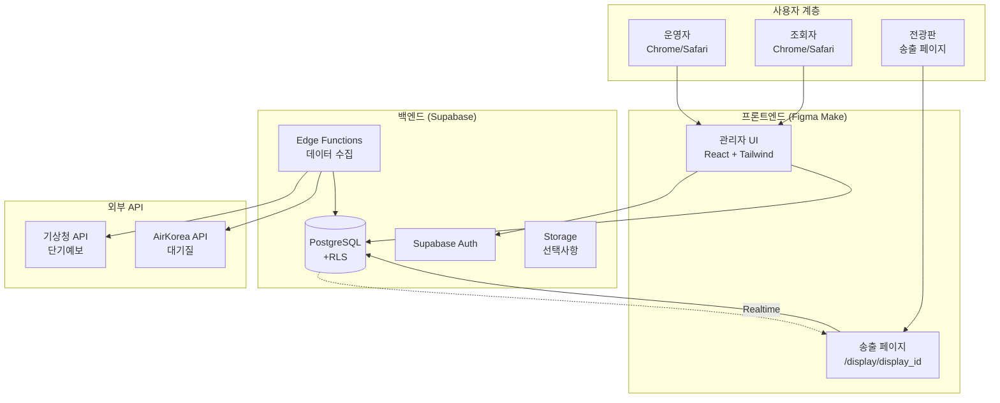
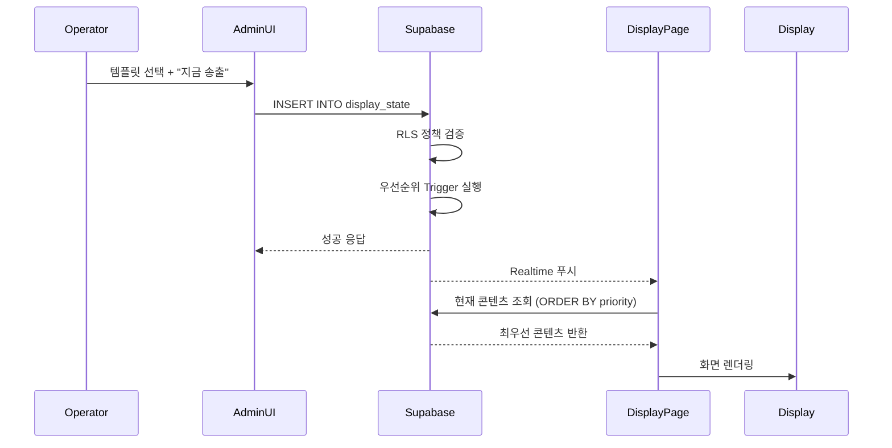
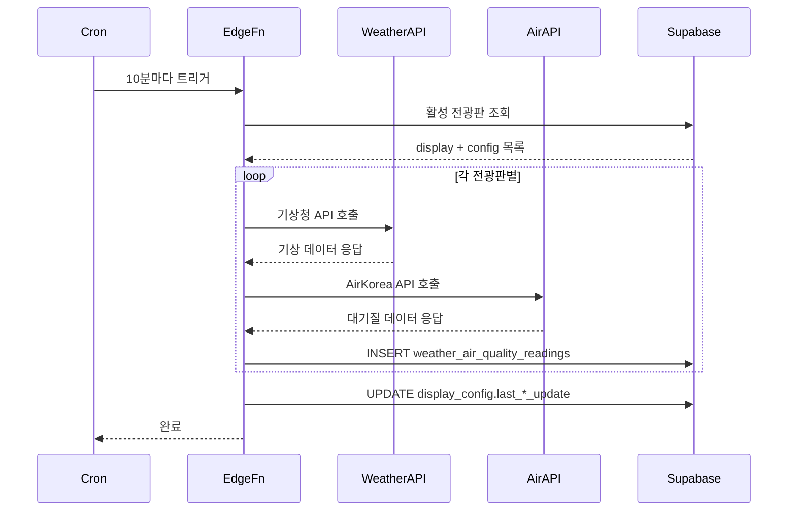
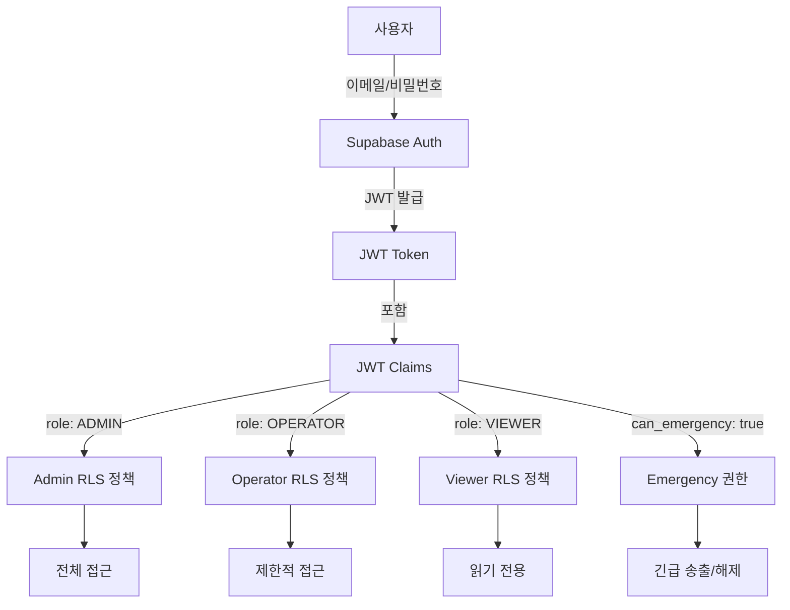

# 02_design / 01_architecture.md

# 시스템 아키텍처

## 1. 전체 시스템 구조

### 1.1 아키텍처 다이어그램



---

## 2. 기술 스택

### 2.1 프론트엔드

| 구성 요소 | 기술 | 버전 | 용도 |
|-----------|------|------|------|
| **프레임워크** | React | 18+ | UI 컴포넌트 |
| **빌드 도구** | Vite | 5+ | 개발 서버, 빌드 |
| **스타일링** | Tailwind CSS | 4.0 | 디자인 시스템 |
| **상태 관리** | React Hooks | - | 로컬 상태 관리 |
| **라우팅** | React Router | 6+ | 페이지 라우팅 |
| **API 클라이언트** | Supabase JS SDK | 2.0+ | Supabase 연동 |
| **아이콘** | Lucide React | - | UI 아이콘 |
| **차트** | Recharts | - | 통계 시각화 |
| **날짜/시간** | date-fns | - | 날짜 포맷팅 |

### 2.2 백엔드

| 구성 요소 | 기술 | 용도 |
|-----------|------|------|
| **데이터베이스** | PostgreSQL 15 | 모든 데이터 저장 |
| **인증** | Supabase Auth | 사용자 인증/권한 |
| **Row Level Security** | PostgreSQL RLS | 데이터 접근 제어 |
| **Edge Functions** | Deno Runtime | 데이터 수집, 스케줄링 |
| **Realtime** | Supabase Realtime | 송출 페이지 자동 갱신 |

### 2.3 배포 및 인프라

| 구성 요소 | 기술 | 용도 |
|-----------|------|------|
| **호스팅** | Vercel / Netlify | 프론트엔드 배포 |
| **데이터베이스 호스팅** | Supabase Cloud | 관리형 PostgreSQL |
| **도메인** | (선택 사항) | 커스텀 도메인 |
| **SSL** | 자동 (Vercel/Netlify) | HTTPS |

---

## 3. 데이터 흐름

### 3.1 송출 프로세스 데이터 흐름



### 3.2 데이터 수집 프로세스 흐름



---

## 4. 컴포넌트 아키텍처

### 4.1 프론트엔드 디렉토리 구조

```
/
├── App.tsx                    # 메인 진입점
├── components/
│   ├── Dashboard.tsx          # 대시보드
│   ├── PreviewStudio.tsx      # 미리보기 Studio
│   ├── Templates.tsx          # 템플릿 관리
│   ├── Schedules.tsx          # 스케줄 관리
│   ├── Displays.tsx           # 전광판 관리
│   ├── AuditLogs.tsx          # 감사 로그
│   ├── DisplayPage.tsx        # 송출 페이지 (/display/:id)
│   └── ui/
│       ├── Button.tsx
│       ├── Input.tsx
│       ├── Select.tsx
│       ├── Modal.tsx
│       └── ...
├── lib/
│   ├── supabase.ts            # Supabase 클라이언트
│   ├── types.ts               # TypeScript 타입 정의
│   └── utils.ts               # 유틸리티 함수
└── styles/
    └── globals.css            # Tailwind 설정
```

### 4.2 주요 컴포넌트 역할

| 컴포넌트 | 역할 | 주요 기능 |
|----------|------|-----------|
| **Dashboard** | 메인 대시보드 | 최근 송출 이력, 통계, 빠른 작업 |
| **PreviewStudio** | 미리보기 Studio | 실시간 미리보기, 송출 설정 |
| **Templates** | 템플릿 관리 | CRUD, 카테고리 필터 |
| **Schedules** | 스케줄 관리 | 캘린더 뷰, 예약/반복 설정 |
| **Displays** | 전광판 관리 | 전광판 등록, 측정소 선택 |
| **AuditLogs** | 감사 로그 | 필터링, CSV Export |
| **DisplayPage** | 송출 페이지 | 전광판 화면 렌더링 (/display/:id) |

---

## 5. 데이터베이스 아키텍처

### 5.1 테이블 계층 구조

```
[핵심 엔티티]
├── displays (전광판)
│   ├── display_config (1:1)
│   ├── display_state (1:N)
│   └── weather_air_quality_readings (1:N)
│
├── message_templates (템플릿)
│   ├── schedules (1:N)
│   └── display_state (1:N)
│
├── weather_stations (기상청 측정소)
│   └── display_config (1:N)
│
└── air_stations (대기질 측정소)
    └── display_config (1:N)

[메타 데이터]
├── schedules (스케줄)
│   └── display_state (1:N, 자동 생성)
│
└── audit_logs (감사 로그)
    └── (모든 테이블 참조)
```

### 5.2 핵심 테이블 관계

**displays ← display_config (1:1)**
- 각 전광판은 하나의 설정을 가짐
- 측정소 선택, 레이아웃 설정

**displays ← display_state (1:N)**
- 각 전광판은 여러 상태를 가질 수 있음 (우선순위별)
- 현재 송출 중인 콘텐츠 결정

**message_templates ← schedules (1:N)**
- 하나의 템플릿은 여러 스케줄에서 재사용 가능

---

## 6. 인증 및 권한 아키텍처

### 6.1 Supabase Auth 구조



### 6.2 RLS (Row Level Security) 정책

| 테이블 | SELECT | INSERT | UPDATE | DELETE |
|--------|--------|--------|--------|--------|
| displays | 전체 | ADMIN | ADMIN | ADMIN |
| message_templates | 전체 | OPERATOR+ | 본인/ADMIN | 본인/ADMIN |
| schedules | 전체 | OPERATOR+ | 본인/ADMIN | 본인/ADMIN |
| display_state | 전체 | OPERATOR+ | OPERATOR+ | EMERGENCY 권한 |
| audit_logs | 전체 | 서비스키만 | 불가 | 불가 |

---

## 7. Edge Functions 아키텍처

### 7.1 Functions 목록

| Function 이름 | 트리거 | 주기 | 역할 |
|---------------|--------|------|------|
| **collect-weather-data** | Cron | 10분 | 기상청 API 호출 및 저장 |
| **collect-air-quality-data** | Cron | 10분 | AirKorea API 호출 및 저장 |
| **sync-air-stations** | Cron | 1일 | 측정소 메타데이터 동기화 |
| **cleanup-old-data** | Cron | 1일 | 7일 이상 데이터 삭제 |
| **activate-schedules** | Cron | 1분 | 예약 송출 자동 활성화 |

### 7.2 Edge Function 구조 (예시)

```typescript
// /supabase/functions/collect-weather-data/index.ts
import { serve } from "std/http/server.ts";
import { createClient } from "@supabase/supabase-js";

serve(async (req) => {
  const supabase = createClient(
    Deno.env.get("SUPABASE_URL")!,
    Deno.env.get("SUPABASE_SERVICE_ROLE_KEY")!
  );

  // 1. 활성 전광판 조회
  const { data: displays } = await supabase
    .from('displays')
    .select('*, display_config(weather_stations(nx, ny))')
    .eq('is_active', true);

  // 2. 각 전광판별 API 호출
  for (const display of displays) {
    const weatherData = await fetchWeatherAPI(...);
    await supabase.from('weather_air_quality_readings').insert({
      display_id: display.id,
      data_type: 'WEATHER',
      ...weatherData
    });
  }

  return new Response(JSON.stringify({ success: true }));
});
```

---

## 8. 송출 페이지 아키텍처

### 8.1 단일 URL 구조

```
/display/{display_id}
```

**예시**:
- `/display/park-main-001`
- `/display/123e4567-e89b-12d3-a456-426614174000`

### 8.2 송출 페이지 렌더링 로직

```typescript
// /components/DisplayPage.tsx
export function DisplayPage() {
  const { displayId } = useParams();
  const [content, setContent] = useState(null);

  useEffect(() => {
    // 1. 현재 콘텐츠 조회
    const fetchContent = async () => {
      const { data } = await supabase.rpc('get_current_content', {
        p_display_id: displayId
      });
      setContent(data);
    };

    fetchContent();

    // 2. Realtime 구독 (자동 갱신)
    const subscription = supabase
      .channel('display_state_changes')
      .on('postgres_changes', {
        event: '*',
        schema: 'public',
        table: 'display_state',
        filter: `display_id=eq.${displayId}`
      }, fetchContent)
      .subscribe();

    return () => subscription.unsubscribe();
  }, [displayId]);

  // 3. 우선순위별 렌더링
  if (content?.content_type === 'EMERGENCY') {
    return <EmergencyView {...content} />;
  } else if (content?.content_type === 'NOTICE') {
    return <NoticeView {...content} />;
  } else {
    return <WeatherView displayId={displayId} />;
  }
}
```

---

## 9. 보안 아키텍처

### 9.1 다층 보안 구조

```
[클라이언트 측]
├── JWT 토큰 검증
├── 역할 기반 UI 제어 (role-based UI)
└── API 키 환경 변수 보호

[서버 측 (Supabase)]
├── RLS 정책 (모든 테이블)
├── 역할 기반 접근 제어 (RBAC)
├── SQL Injection 방지 (Prepared Statements)
└── HTTPS 강제 (TLS 1.3)

[네트워크]
├── CORS 정책
├── Rate Limiting (API Gateway)
└── DDoS 방어 (Vercel/Netlify)
```

### 9.2 API 키 관리

**저장 위치**:
- ❌ 클라이언트 코드 (절대 금지)
- ✅ Supabase Edge Functions 환경 변수
- ✅ Vercel/Netlify 환경 변수 (NEXT_PUBLIC_*는 제외)

**접근 방식**:
```typescript
// ❌ 잘못된 예시 (클라이언트에서 직접 호출)
const weatherData = await fetch(`${API_URL}?serviceKey=${API_KEY}`);

// ✅ 올바른 예시 (Edge Function에서 호출)
const { data } = await supabase.functions.invoke('collect-weather-data');
```

---

## 10. 성능 최적화 아키텍처

### 10.1 데이터베이스 최적화

| 최적화 기법 | 적용 위치 | 효과 |
|-------------|-----------|------|
| **인덱스** | display_id, priority, created_at | 조회 속도 10배↑ |
| **뷰 (View)** | v_current_display_content | 복잡한 쿼리 단순화 |
| **함수 (Function)** | get_current_content() | 재사용성, 성능 향상 |
| **GIN 인덱스** | schedules.display_ids (JSONB) | JSONB 검색 최적화 |

### 10.2 프론트엔드 최적화

| 최적화 기법 | 적용 위치 | 효과 |
|-------------|-----------|------|
| **Code Splitting** | React.lazy() | 초기 로딩 시간 단축 |
| **Memoization** | useMemo, useCallback | 불필요한 렌더링 방지 |
| **Debounce** | 검색, 필터 입력 | API 호출 최소화 |
| **Image Optimization** | (선택 사항) | 미적용 (텍스트만 사용) |

### 10.3 캐싱 전략

| 데이터 타입 | 캐싱 방법 | TTL |
|-------------|-----------|-----|
| **현재 송출 콘텐츠** | Supabase Realtime | 실시간 |
| **날씨·대기질 데이터** | 클라이언트 메모리 | 10분 |
| **측정소 메타데이터** | Supabase 테이블 | 1일 |
| **사용자 정보** | Supabase Auth | 세션 유지 |

---

## 11. 확장성 고려사항

### 11.1 수평 확장 (Horizontal Scaling)

| 구성 요소 | 확장 방법 |
|-----------|-----------|
| **프론트엔드** | Vercel/Netlify 자동 확장 (CDN) |
| **데이터베이스** | Supabase Pro 플랜 (Connection Pooling) |
| **Edge Functions** | Supabase 자동 확장 (Serverless) |

### 11.2 타 지자체 확산 시나리오

**단계 1: 템플릿 복제**
- 기존 message_templates Export
- 새 지자체에 Import

**단계 2: 측정소 재설정**
- 지역별 weather_stations, air_stations 수집
- display_config 업데이트

**단계 3: 커스터마이징**
- 색상, 폰트, 레이아웃 조정
- 지역 특화 카테고리 추가

**예상 소요 시간**: 1~2일 (설정 변경만)

---

## 12. 문서 히스토리

| 버전 | 날짜 | 작성자 | 변경 내용 |
|------|------|--------|-----------|
| v1.0.0 | 2024-12-16 | 프로젝트팀 | 초안 작성 (완성형) |

---

**다음 문서**: [02_erd.md](./02_erd.md)
