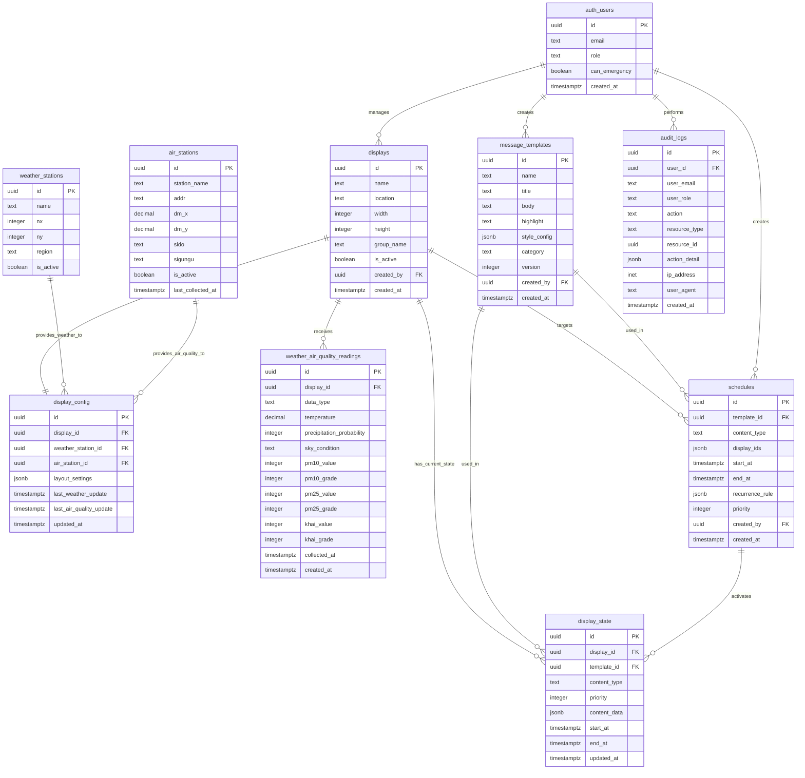
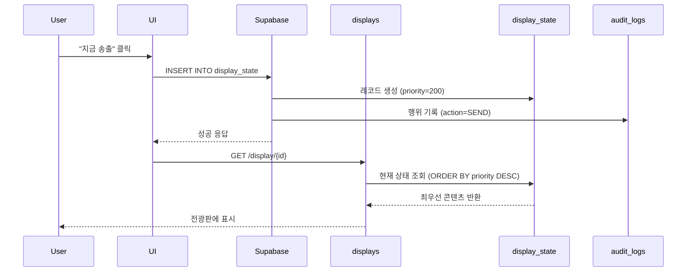
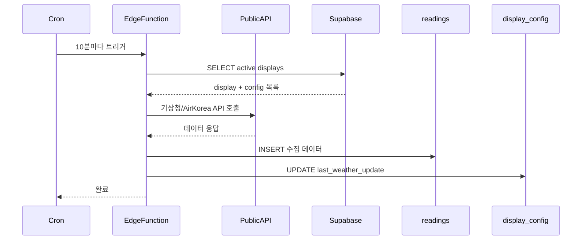

# 02_design / 02_erd.md

# ERD 및 테이블 관계도

## 1. 전체 ERD



---

## 2. 테이블 관계 상세

### 2.1 핵심 관계

#### displays ↔ display_config (1:1)
- **관계 유형**: One-to-One
- **FK**: display_config.display_id → displays.id
- **설명**: 각 전광판은 하나의 설정을 가짐
- **삭제 정책**: CASCADE (전광판 삭제 시 설정도 삭제)

#### displays ↔ display_state (1:N)
- **관계 유형**: One-to-Many
- **FK**: display_state.display_id → displays.id
- **설명**: 각 전광판은 현재/과거 상태를 여러 개 가질 수 있음 (이력 관리)
- **삭제 정책**: CASCADE

#### displays ↔ weather_air_quality_readings (1:N)
- **관계 유형**: One-to-Many
- **FK**: weather_air_quality_readings.display_id → displays.id
- **설명**: 각 전광판은 여러 데이터 수집 레코드를 가짐
- **삭제 정책**: CASCADE

#### message_templates ↔ schedules (1:N)
- **관계 유형**: One-to-Many
- **FK**: schedules.template_id → message_templates.id
- **설명**: 하나의 템플릿은 여러 스케줄에서 재사용 가능
- **삭제 정책**: RESTRICT (템플릿 삭제 시 스케줄 있으면 차단)

#### weather_stations ↔ display_config (1:N)
- **관계 유형**: One-to-Many
- **FK**: display_config.weather_station_id → weather_stations.id
- **설명**: 하나의 기상청 측정소는 여러 전광판에서 사용 가능
- **삭제 정책**: RESTRICT

#### air_stations ↔ display_config (1:N)
- **관계 유형**: One-to-Many
- **FK**: display_config.air_station_id → air_stations.id
- **설명**: 하나의 대기질 측정소는 여러 전광판에서 사용 가능
- **삭제 정책**: RESTRICT

### 2.2 사용자 관계

#### auth.users ↔ displays (1:N)
- **FK**: displays.created_by → auth.users.id
- **설명**: 전광판 등록자 추적

#### auth.users ↔ message_templates (1:N)
- **FK**: message_templates.created_by → auth.users.id
- **설명**: 템플릿 생성자 추적

#### auth.users ↔ schedules (1:N)
- **FK**: schedules.created_by → auth.users.id
- **설명**: 스케줄 생성�� 추적

#### auth.users ↔ audit_logs (1:N)
- **FK**: audit_logs.user_id → auth.users.id
- **설명**: 모든 행위를 사용자별로 추적

---

## 3. 테이블별 상세 스키마

### 3.1 displays (전광판)

**목적**: 전광판 기본 정보 관리

```sql
CREATE TABLE displays (
  id UUID PRIMARY KEY DEFAULT gen_random_uuid(),
  name TEXT NOT NULL UNIQUE,
  location TEXT,
  width INTEGER NOT NULL,
  height INTEGER NOT NULL,
  group_name TEXT,
  is_active BOOLEAN DEFAULT true,
  created_by UUID REFERENCES auth.users(id),
  created_at TIMESTAMPTZ DEFAULT NOW(),
  updated_at TIMESTAMPTZ DEFAULT NOW()
);

CREATE INDEX idx_displays_active ON displays(is_active);
CREATE INDEX idx_displays_group ON displays(group_name);
```

**제약 조건**:
- `name`: UNIQUE (중복 방지)
- `width`, `height`: CHECK (width > 0 AND height > 0)

---

### 3.2 display_config (전광판 설정)

**목적**: 전광판별 개별 설정 (측정소, 레이아웃 등)

```sql
CREATE TABLE display_config (
  id UUID PRIMARY KEY DEFAULT gen_random_uuid(),
  display_id UUID NOT NULL UNIQUE REFERENCES displays(id) ON DELETE CASCADE,
  weather_station_id UUID REFERENCES weather_stations(id) ON DELETE RESTRICT,
  air_station_id UUID REFERENCES air_stations(id) ON DELETE RESTRICT,
  layout_settings JSONB DEFAULT '{}',
  last_weather_update TIMESTAMPTZ,
  last_air_quality_update TIMESTAMPTZ,
  created_at TIMESTAMPTZ DEFAULT NOW(),
  updated_at TIMESTAMPTZ DEFAULT NOW()
);

CREATE UNIQUE INDEX idx_display_config_display ON display_config(display_id);
```

**layout_settings 예시**:
```json
{
  "frame_color": "#000000",
  "frame_width": 10,
  "safe_margin": 20,
  "font_family": "Noto Sans KR",
  "background_color": "#FFFFFF"
}
```

---

### 3.3 weather_stations (기상청 측정소)

**목적**: 기상청 단기예보 API 호출용 좌표 관리

```sql
CREATE TABLE weather_stations (
  id UUID PRIMARY KEY DEFAULT gen_random_uuid(),
  name TEXT NOT NULL UNIQUE,
  nx INTEGER NOT NULL,
  ny INTEGER NOT NULL,
  region TEXT,
  is_active BOOLEAN DEFAULT true,
  created_at TIMESTAMPTZ DEFAULT NOW(),
  updated_at TIMESTAMPTZ DEFAULT NOW()
);

CREATE INDEX idx_weather_stations_active ON weather_stations(is_active);
```

**예시 데이터**:
| name | nx | ny | region |
|------|----|----|--------|
| 고양시청 | 59 | 127 | 경기 고양시 |
| 일산동구 | 60 | 127 | 경기 고양시 일산동구 |

---

### 3.4 air_stations (대기질 측정소)

**목적**: AirKorea API 호출용 측정소 메타데이터

```sql
CREATE TABLE air_stations (
  id UUID PRIMARY KEY DEFAULT gen_random_uuid(),
  station_name TEXT NOT NULL UNIQUE,
  addr TEXT,
  dm_x DECIMAL(10, 7),
  dm_y DECIMAL(10, 7),
  sido TEXT,
  sigungu TEXT,
  is_active BOOLEAN DEFAULT true,
  last_collected_at TIMESTAMPTZ,
  created_at TIMESTAMPTZ DEFAULT NOW(),
  updated_at TIMESTAMPTZ DEFAULT NOW()
);

CREATE INDEX idx_air_stations_sido ON air_stations(sido);
CREATE INDEX idx_air_stations_sigungu ON air_stations(sigungu);
CREATE INDEX idx_air_stations_name ON air_stations(station_name);
```

**예시 데이터**:
| station_name | addr | dm_x | dm_y | sido | sigungu |
|--------------|------|------|------|------|---------|
| 일산동구 | 경기도 고양시 일산동구 중산동 | 126.7719 | 37.6583 | 경기 | 고양시 |

---

### 3.5 message_templates (메시지 템플릿)

**목적**: NOTICE/EMERGENCY 콘텐츠 템플릿 관리

```sql
CREATE TABLE message_templates (
  id UUID PRIMARY KEY DEFAULT gen_random_uuid(),
  name TEXT NOT NULL,
  title TEXT NOT NULL,
  body TEXT NOT NULL,
  highlight TEXT,
  style_config JSONB DEFAULT '{}',
  category TEXT,
  version INTEGER DEFAULT 1,
  created_by UUID REFERENCES auth.users(id),
  created_at TIMESTAMPTZ DEFAULT NOW(),
  updated_at TIMESTAMPTZ DEFAULT NOW()
);

CREATE INDEX idx_templates_category ON message_templates(category);
CREATE INDEX idx_templates_created_by ON message_templates(created_by);
```

**style_config 예시**:
```json
{
  "title_color": "#0066CC",
  "body_color": "#333333",
  "highlight_color": "#FF0000",
  "background": "#FFFFFF",
  "title_size": "32px",
  "body_size": "24px",
  "alignment": "center",
  "icon": "alert-triangle"
}
```

**category 값**:
- `대관`
- `방역`
- `캠페인`
- `안전`
- `공지`

---

### 3.6 schedules (송출 스케줄)

**목적**: 예약/반복 송출 스케줄 관리

```sql
CREATE TABLE schedules (
  id UUID PRIMARY KEY DEFAULT gen_random_uuid(),
  template_id UUID REFERENCES message_templates(id) ON DELETE RESTRICT,
  content_type TEXT NOT NULL CHECK (content_type IN ('NOTICE', 'EMERGENCY')),
  display_ids JSONB NOT NULL,
  start_at TIMESTAMPTZ NOT NULL,
  end_at TIMESTAMPTZ NOT NULL,
  recurrence_rule JSONB,
  priority INTEGER DEFAULT 200,
  created_by UUID REFERENCES auth.users(id),
  created_at TIMESTAMPTZ DEFAULT NOW(),
  updated_at TIMESTAMPTZ DEFAULT NOW(),
  
  CONSTRAINT valid_time_range CHECK (end_at > start_at)
);

CREATE INDEX idx_schedules_start_end ON schedules(start_at, end_at);
CREATE INDEX idx_schedules_display_ids ON schedules USING GIN(display_ids);
```

**display_ids 예시**:
```json
["uuid-1", "uuid-2", "uuid-3"]
// 또는 전체 선택 시
["*"]
```

**recurrence_rule 예시**:
```json
{
  "frequency": "WEEKLY",
  "byday": ["MO", "WE", "FR"],
  "start_time": "09:00",
  "end_time": "12:00",
  "timezone": "Asia/Seoul"
}
```

---

### 3.7 display_state (전광판 현재 상태)

**목적**: 전광판별 현재 송출 상태 및 우선순위 관리

```sql
CREATE TABLE display_state (
  id UUID PRIMARY KEY DEFAULT gen_random_uuid(),
  display_id UUID NOT NULL REFERENCES displays(id) ON DELETE CASCADE,
  template_id UUID REFERENCES message_templates(id) ON DELETE SET NULL,
  content_type TEXT NOT NULL CHECK (content_type IN ('WEATHER', 'NOTICE', 'EMERGENCY')),
  priority INTEGER NOT NULL,
  content_data JSONB,
  start_at TIMESTAMPTZ,
  end_at TIMESTAMPTZ,
  created_at TIMESTAMPTZ DEFAULT NOW(),
  updated_at TIMESTAMPTZ DEFAULT NOW()
);

CREATE INDEX idx_display_state_display_priority ON display_state(display_id, priority DESC, updated_at DESC);
CREATE INDEX idx_display_state_active ON display_state(display_id, start_at, end_at);
```

**우선순위 값**:
- `300`: EMERGENCY
- `200`: NOTICE
- `100`: WEATHER

**현재 송출 콘텐츠 조회 쿼리**:
```sql
SELECT * FROM display_state
WHERE display_id = {display_id}
  AND (start_at IS NULL OR start_at <= NOW())
  AND (end_at IS NULL OR end_at >= NOW())
ORDER BY priority DESC, updated_at DESC
LIMIT 1;
```

---

### 3.8 weather_air_quality_readings (날씨·대기질 수집 데이터)

**목적**: 공공데이터 API 수집 결과 저장

```sql
CREATE TABLE weather_air_quality_readings (
  id UUID PRIMARY KEY DEFAULT gen_random_uuid(),
  display_id UUID NOT NULL REFERENCES displays(id) ON DELETE CASCADE,
  data_type TEXT NOT NULL CHECK (data_type IN ('WEATHER', 'AIR_QUALITY')),
  
  -- 기상 데이터
  temperature DECIMAL(4, 1),
  precipitation_probability INTEGER,
  sky_condition TEXT,
  humidity INTEGER,
  wind_speed DECIMAL(4, 1),
  
  -- 대기질 데이터
  pm10_value INTEGER,
  pm10_grade INTEGER CHECK (pm10_grade BETWEEN 1 AND 4),
  pm25_value INTEGER,
  pm25_grade INTEGER CHECK (pm25_grade BETWEEN 1 AND 4),
  khai_value INTEGER,
  khai_grade INTEGER CHECK (khai_grade BETWEEN 1 AND 4),
  
  collected_at TIMESTAMPTZ NOT NULL,
  created_at TIMESTAMPTZ DEFAULT NOW()
);

CREATE INDEX idx_readings_display_type_collected ON weather_air_quality_readings(display_id, data_type, collected_at DESC);
```

**데이터 보관 정책**:
- 최근 7일: 전체 보관
- 7일 이상: 자동 삭제 (Edge Function)

---

### 3.9 audit_logs (감사 로그)

**목적**: 모든 사용자 행위 추적 및 증빙

```sql
CREATE TABLE audit_logs (
  id UUID PRIMARY KEY DEFAULT gen_random_uuid(),
  user_id UUID REFERENCES auth.users(id),
  user_email TEXT NOT NULL,
  user_role TEXT NOT NULL,
  action TEXT NOT NULL,
  resource_type TEXT NOT NULL,
  resource_id UUID,
  action_detail JSONB,
  ip_address INET,
  user_agent TEXT,
  created_at TIMESTAMPTZ DEFAULT NOW()
);

CREATE INDEX idx_audit_logs_created_at ON audit_logs(created_at DESC);
CREATE INDEX idx_audit_logs_user ON audit_logs(user_id, created_at DESC);
CREATE INDEX idx_audit_logs_action ON audit_logs(action);
CREATE INDEX idx_audit_logs_resource ON audit_logs(resource_type, resource_id);
```

**action 값**:
- `CREATE`, `UPDATE`, `DELETE`: 일반 CRUD
- `SEND`: 즉시/예약 송출
- `EMERGENCY_SEND`: 긴급 송출
- `EMERGENCY_RELEASE`: 긴급 해제
- `API_ERROR`: 공공데이터 API 오류

**action_detail 예시**:
```json
{
  "template_name": "방역 안내",
  "display_ids": ["uuid-1", "uuid-2"],
  "start_at": "2024-06-01 09:00:00",
  "end_at": "2024-06-01 12:00:00"
}
```

---

## 4. 뷰 (Views)

### 4.1 v_current_display_content (현재 송출 콘텐츠 뷰)

**목적**: 각 전광판의 현재 송출 중인 콘텐츠를 한눈에 조회

```sql
CREATE OR REPLACE VIEW v_current_display_content AS
SELECT DISTINCT ON (ds.display_id)
  d.id AS display_id,
  d.name AS display_name,
  d.location,
  ds.content_type,
  ds.priority,
  mt.title,
  mt.body,
  mt.highlight,
  mt.style_config,
  ds.start_at,
  ds.end_at,
  ds.updated_at
FROM displays d
LEFT JOIN display_state ds ON d.id = ds.display_id
  AND (ds.start_at IS NULL OR ds.start_at <= NOW())
  AND (ds.end_at IS NULL OR ds.end_at >= NOW())
LEFT JOIN message_templates mt ON ds.template_id = mt.id
WHERE d.is_active = true
ORDER BY ds.display_id, ds.priority DESC, ds.updated_at DESC;
```

**사용 예시**:
```sql
-- 모든 전광판의 현재 송출 콘텐츠 조회
SELECT * FROM v_current_display_content;

-- 특정 전광판의 현재 콘텐츠 조회
SELECT * FROM v_current_display_content WHERE display_id = {uuid};
```

---

### 4.2 v_latest_weather_air_quality (최신 날씨·대기질 뷰)

**목적**: 각 전광판의 최신 수집 데이터 조회

```sql
CREATE OR REPLACE VIEW v_latest_weather_air_quality AS
SELECT DISTINCT ON (display_id, data_type)
  display_id,
  data_type,
  temperature,
  precipitation_probability,
  sky_condition,
  pm10_value,
  pm10_grade,
  pm25_value,
  pm25_grade,
  khai_value,
  khai_grade,
  collected_at,
  CASE
    WHEN collected_at > NOW() - INTERVAL '10 minutes' THEN 'NORMAL'
    WHEN collected_at > NOW() - INTERVAL '1 hour' THEN 'DELAYED'
    ELSE 'FAILED'
  END AS status
FROM weather_air_quality_readings
ORDER BY display_id, data_type, collected_at DESC;
```

**사용 예시**:
```sql
-- 전광판의 최신 기상 정보 조회
SELECT * FROM v_latest_weather_air_quality
WHERE display_id = {uuid} AND data_type = 'WEATHER';

-- 상태별 통계
SELECT status, COUNT(*) FROM v_latest_weather_air_quality
GROUP BY status;
```

---

## 5. 트리거 (Triggers)

### 5.1 update_timestamp (자동 updated_at 갱신)

```sql
CREATE OR REPLACE FUNCTION update_timestamp()
RETURNS TRIGGER AS $$
BEGIN
  NEW.updated_at = NOW();
  RETURN NEW;
END;
$$ LANGUAGE plpgsql;

CREATE TRIGGER trg_displays_updated_at
BEFORE UPDATE ON displays
FOR EACH ROW EXECUTE FUNCTION update_timestamp();

CREATE TRIGGER trg_display_config_updated_at
BEFORE UPDATE ON display_config
FOR EACH ROW EXECUTE FUNCTION update_timestamp();

CREATE TRIGGER trg_message_templates_updated_at
BEFORE UPDATE ON message_templates
FOR EACH ROW EXECUTE FUNCTION update_timestamp();
```

---

### 5.2 increment_template_version (템플릿 버전 자동 증가)

```sql
CREATE OR REPLACE FUNCTION increment_template_version()
RETURNS TRIGGER AS $$
BEGIN
  IF OLD.title != NEW.title OR OLD.body != NEW.body OR OLD.style_config::TEXT != NEW.style_config::TEXT THEN
    NEW.version = OLD.version + 1;
  END IF;
  RETURN NEW;
END;
$$ LANGUAGE plpgsql;

CREATE TRIGGER trg_template_version
BEFORE UPDATE ON message_templates
FOR EACH ROW EXECUTE FUNCTION increment_template_version();
```

---

## 6. 인덱스 전략

### 6.1 성능 최적화 인덱스

| 테이블 | 인덱스 | 목적 |
|--------|--------|------|
| displays | is_active | 활성 전광판 필터링 |
| display_state | (display_id, priority DESC) | 우선순위 정렬 최적화 |
| weather_air_quality_readings | (display_id, data_type, collected_at DESC) | 최신 데이터 조회 |
| audit_logs | created_at DESC | 최근 로그 조회 |
| schedules | (start_at, end_at) | 시간 범위 검색 |

### 6.2 GIN 인덱스 (JSONB)

```sql
-- schedules.display_ids JSONB 배열 검색 최적화
CREATE INDEX idx_schedules_display_ids ON schedules USING GIN(display_ids);

-- 사용 예시
SELECT * FROM schedules WHERE display_ids @> '["uuid-1"]'::jsonb;
```

---

## 7. 제약 조건 (Constraints)

### 7.1 CHECK 제약

```sql
-- displays: 해상도 양수 검증
ALTER TABLE displays ADD CONSTRAINT chk_displays_resolution
  CHECK (width > 0 AND height > 0);

-- schedules: 시간 범위 검증
ALTER TABLE schedules ADD CONSTRAINT chk_schedules_time_range
  CHECK (end_at > start_at);

-- weather_air_quality_readings: 등급 범위 검증
ALTER TABLE weather_air_quality_readings ADD CONSTRAINT chk_readings_grade
  CHECK (
    (pm10_grade IS NULL OR pm10_grade BETWEEN 1 AND 4) AND
    (pm25_grade IS NULL OR pm25_grade BETWEEN 1 AND 4) AND
    (khai_grade IS NULL OR khai_grade BETWEEN 1 AND 4)
  );
```

### 7.2 UNIQUE 제약

```sql
-- displays.name: 전광판 이름 중복 방지
-- display_config.display_id: 1:1 관계 보장
-- weather_stations.name, air_stations.station_name: 측정소 중복 방지
```

---

## 8. 삭제 정책 (ON DELETE)

| 부모 테이블 | 자식 테이블 | 정책 | 이유 |
|-------------|-------------|------|------|
| displays | display_config | CASCADE | 전광판 삭제 시 설정도 삭제 |
| displays | display_state | CASCADE | 전광판 삭제 시 상태도 삭제 |
| displays | weather_air_quality_readings | CASCADE | 전광판 삭제 시 수집 데이터도 삭제 |
| message_templates | schedules | RESTRICT | 템플릿 삭제 시 스케줄 있으면 차단 |
| message_templates | display_state | SET NULL | 템플릿 삭제 시 NULL로 설정 (데이터 보존) |
| weather_stations | display_config | RESTRICT | 측정소 삭제 시 전광판 설정 있으면 차단 |
| air_stations | display_config | RESTRICT | 측정소 삭제 시 전광판 설정 있으면 차단 |

---

## 9. 데이터 흐름도

### 9.1 송출 프로세스 데이터 흐름



### 9.2 데이터 수집 프로세스 데이터 흐름



---

## 10. 문서 히스토리

| 버전 | 날짜 | 작성자 | 변경 내용 |
|------|------|--------|-----------|
| v1.0.0 | 2024-12-16 | 프로젝트팀 | 초안 작성 (완성형) |

---

**이전 문서**: [01_architecture.md](./01_architecture.md)  
**다음 문서**: [03_data_dictionary.md](./03_data_dictionary.md)
